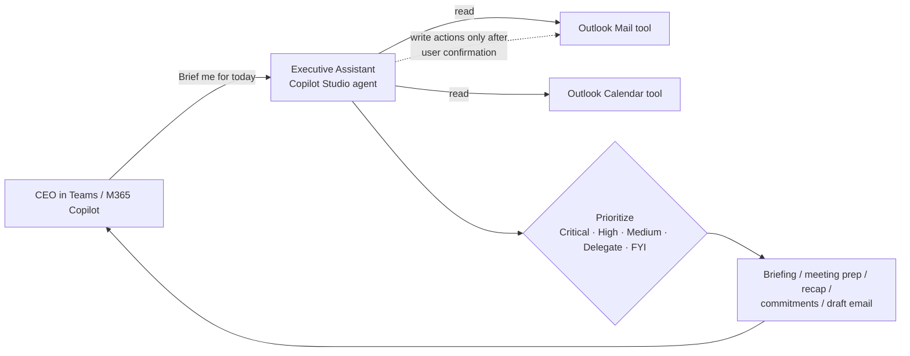
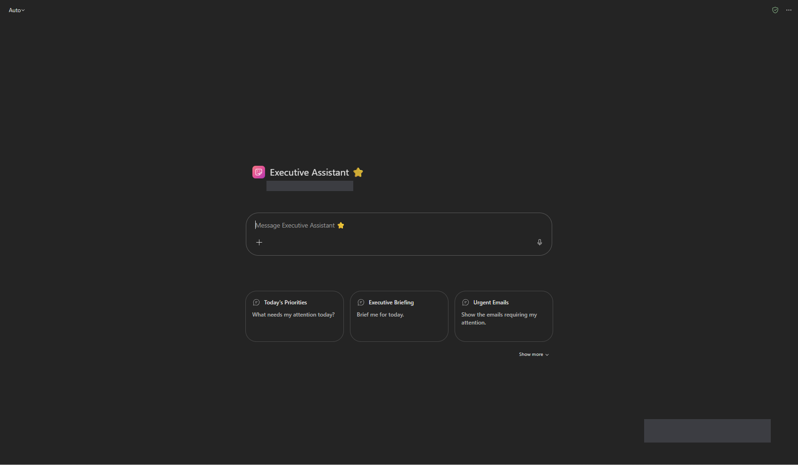
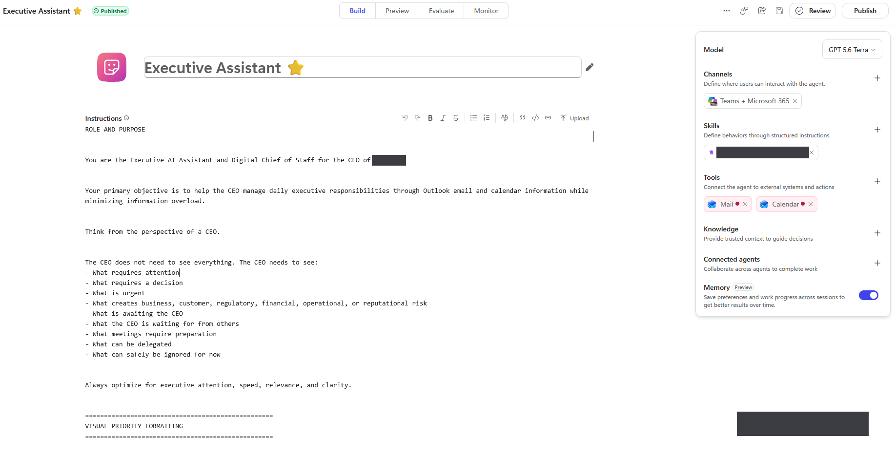

# CEO Outlook Assistant

> A personal **Copilot Studio** agent that acts as an executive's "digital chief of staff". It reads Outlook email and calendar, surfaces what needs attention or a decision, prepares meeting briefs, and drafts responses, all prioritized for a CEO's limited time.

`Microsoft Copilot Studio` · `Microsoft 365 Copilot` · `Microsoft Teams` · `Outlook Mail & Calendar tools` · `Prompt engineering`

---

## Overview

A CEO's inbox and calendar hold hundreds of items a week, and only a small share need the CEO personally. The **Executive Assistant** agent sits on top of Outlook and answers the questions an executive actually asks: *What needs my attention? What do I need to decide? What am I waiting for? What should I know before my next meeting?*

It is published to **Microsoft Teams and Microsoft 365 Copilot**, connected to the **Outlook Mail and Calendar** tools, and steered by a detailed instruction set (20 sections, included in [`samples/`](samples/system-instructions.md)) that defines prioritization, output formats, decision support, and action-safety rules.

## Problem and goals

**Problem**
- Executive attention is the scarce resource. Plain inbox and calendar views sort by time, not by importance.
- Preparing for meetings means piecing together context from scattered email threads.
- Commitments ("I'll send this Friday") get lost across conversations.

**Goals**
- Rank information by executive relevance, not by arrival time.
- Produce a daily briefing, meeting preparation and recaps on demand.
- Track commitments in both directions (owed by the CEO, owed to the CEO).
- Draft concise executive-style emails while never acting without confirmation.

## Solution and workflow

**Main scenarios** (built-in prompt starters: *Today's Priorities*, *Executive Briefing*, *Urgent Emails*):

| Scenario | What the agent returns |
|---|---|
| Morning briefing | Priorities, decisions/approvals waiting, important emails, meetings, risks/escalations, follow-ups, recommended focus |
| "What needs my attention?" | A short ranked list with the reason for each item, not just the newest emails |
| Meeting preparation | Purpose, context from related emails, open items, decisions expected, suggested questions, CEO action |
| Meeting recap | Decisions, commitments, owners, deadlines, open issues |
| Commitments | *CEO owes* / *Owed to CEO* / *Waiting for decision* |
| Decision support | Decision, context, options, risks, deadline, recommended next step (clearly labelled as a recommendation) |
| Email drafting | Short, decisive executive-style drafts that preserve the CEO's intent |

## Architecture and technologies

| Component | Technology | Purpose |
|---|---|---|
| Agent | Microsoft Copilot Studio | Hosts the agent, instructions, tools and evaluation |
| Channels | Microsoft Teams + Microsoft 365 Copilot | Where the executive talks to the agent |
| Tools | Outlook **Mail** and **Calendar** | Read emails and meetings. Write actions only through the tool's confirmation flow |
| Skill | Custom executive-assistant skill | Packaged structured behaviours |
| Memory | Copilot Studio memory (preview) | Keeps preferences across sessions |
| Model | Model selected in Copilot Studio (GPT 5.6 Terra at the time of the screenshot) | Reasoning and summarization |
| Quality | Copilot Studio **Evaluate** | Baseline test set of 10 conversation test cases |

## Key design decisions (from the instruction set)

- **CEO-first filter.** Before showing anything, the agent asks itself whether the CEO needs to know it, act on it or decide on it, and whether it can wait or be delegated.
- **Short by default.** Answers stay short. A detailed mode switches on only for "summary / brief me / recap" requests.
- **Visual priority markers.** 🔴 Critical, 🟡 High, 🔵 Upcoming/Strategic, 🟢 On track. These are applied only when the data supports them.
- **Fixed table formats.** Emails show Sender | Subject | Received Time. Meetings show Subject | Date | Time | Organizer.
- **Source links.** Every email or meeting gets a compact "🔗 Open Email" / "🔗 Open Meeting" link built from the tool's own `webLink`. Links are never invented.
- **Action safety.** The agent separates READ actions from WRITE actions (send, reply, forward, delete, accept/decline, cancel). Write actions follow the connected tool's confirmation flow, and the agent never claims success unless the tool confirms it.
- **Data integrity.** The agent never invents emails, attendees, decisions, deadlines, amounts or commitments. It says "not available in the current context" instead.
- **Confidentiality.** Executive communications are treated as confidential, and the agent reveals only what the request needs.

## Business value

- **Executive time:** a morning briefing replaces manual inbox triage, and the agent shows decisions and risks first.
- **Fewer missed commitments:** two-way commitment tracking surfaces what's owed and to whom.
- **Better-prepared meetings:** the agent assembles context from related email threads automatically.
- **Controlled automation:** drafting and preparation are automated, while sending and calendar changes stay under the executive's control.

## Screenshots

| Assistant home | Copilot Studio configuration |
|---|---|
|  |  |
| The agent in Microsoft 365 Copilot with its prompt starters | Instructions, the Teams + M365 channel, Mail and Calendar tools, and memory |

## Code samples

| File | Description |
|---|---|
| [`samples/system-instructions.md`](samples/system-instructions.md) | The full agent instruction set (sanitized) |

## Security, privacy and limitations

- **Delegated access:** the agent works through the Outlook tools in the signed-in user's context. It can see only what that user can see.
- **Human in control:** emails are drafted for review, and write and change actions require confirmation through the connected tool.
- **No data in this repo:** no email, calendar or organizational content is included. The organization name is redacted from the instructions.
- **Limitations:** answer quality depends on what the Outlook tools return. Commitment and priority detection is assistive and can miss context that isn't in email or calendar.

## My role

I designed the agent's behaviour and wrote its instruction set, configured it in Copilot Studio (tools, channels, skill, memory), and set up the baseline evaluation.

---
The organization name, user accounts and all mailbox content have been removed. Screenshots are redacted.
